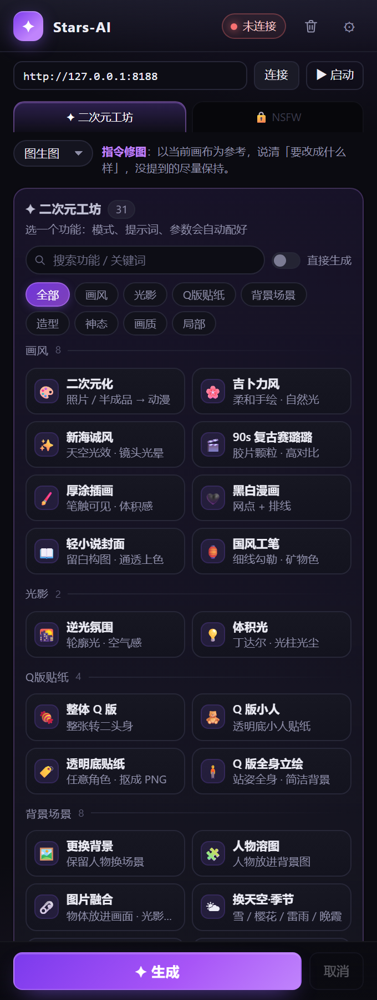
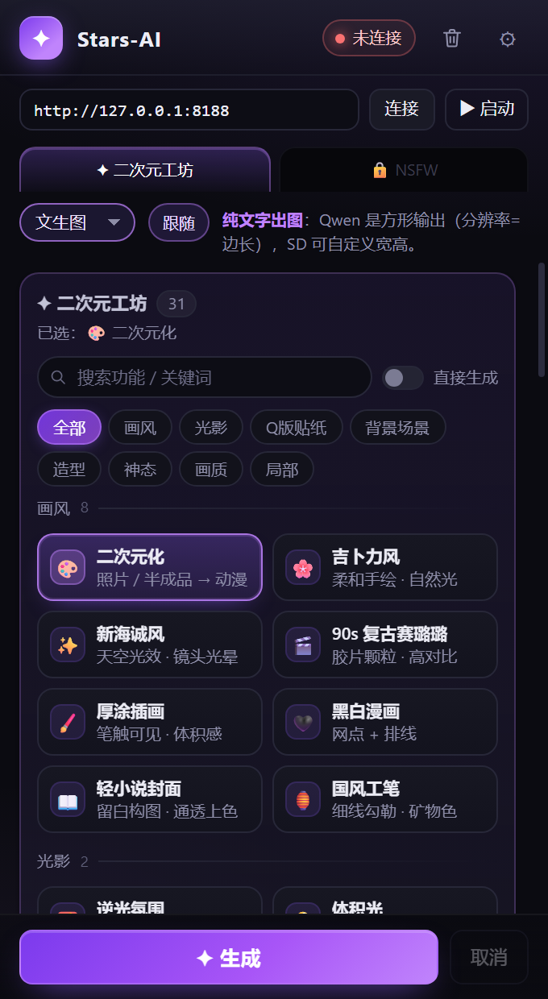
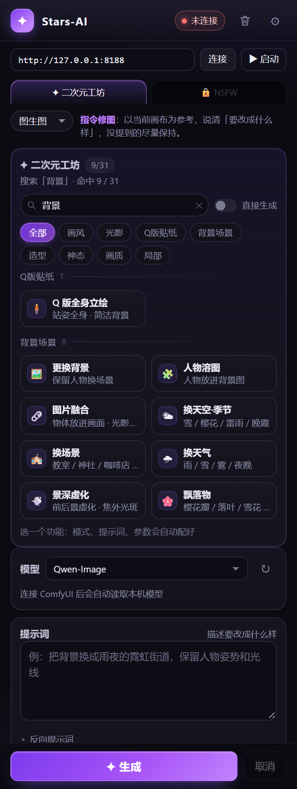
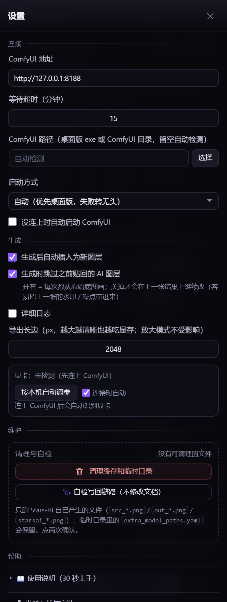

# Stars-AI ✦ Photoshop × 本地 ComfyUI 的 AI 修图面板

在 Photoshop 里框一块、写一句话，剩下的交给你自己机器上的 ComfyUI。结果作为新图层贴回原位，原图一个像素不动。
**全部本地算力：不联网、不上传、不需要账号。**



> ## ⚠️ 这里只有源码
>
> - ❌ 不提供打包好的插件（没有 `.zxp` / `.zip` / `.exe`）
> - ❌ 不提供安装或使用支持，也不保证在你的机器上能跑
> - ❌ **不附带任何模型权重**（UNET / VAE / 文本编码器 / LoRA / 放大模型 / 抠图模型都要你自备）
> - ❌ 不含 ComfyUI 本体、不含 Photoshop
> - ✅ 有的只是源码：PS 侧 ExtendScript + CEP 面板 + ComfyUI 工作流图构建 + 几个离线测试脚本
>
> 这是一个自用工具的开源版本。README 会把「它怎么搭起来的」写清楚，但不承诺「你照着做就能跑」——
> 中间涉及 Photoshop/CEP、ComfyUI 版本、模型文件名、显存，这些都要你自己对。

---

## 界面

| 功能卡自动带出模式，也可以手动锁定 | 61 个功能可搜索 |
| --- | --- |
|  |  |

设置抽屉（模型、显存分档、维护、内置文档）：



---

## 它做什么

一句话：**用「功能卡」代替写提示词，把 ComfyUI 变成 Photoshop 里的一个修图工具。**

点一张卡 → 模式、提示词、负面词、参数全部自动配好 → 生成 → 结果自动贴回画布。
不满意就换个种子再来一次，或者直接改提示词。

- **两个工坊 61 个功能**：二次元 31（画风 / 光影 / Q 版贴纸 / 背景场景 / 造型 / 神态 / 画质 / 局部）、NSFW 30（服装类 / 配饰 / 身体类 / 肤质 / 表情 / 场景光线 / 局部重绘）
- **五种模式**：文生图 / 图生图 / 局部重绘 / 放大 / 自定义（导入任意 ComfyUI API 工作流 JSON）
- **局部重绘按真实形状合成**：套索、魔棒画出来的不规则选区不会被抹成方块；选区单独裁出来送去生成，清晰度靠这个
- **写回永不删像素**：结果只作为新图层贴回，选区合成在 ComfyUI 里用 alpha 完成，PS 侧不执行「反选 + 删除」
- **模型自动识别**：UNET / VAE / 文本编码器 / LoRA / 放大模型 / 抠图模型从 ComfyUI 现读，不用手填名字
- **按显存自动调参**：读 `/system_stats` 拿到显卡型号与显存，分 5 档给参考分辨率 / 步数 / 导出长边
- **面板内启动 ComfyUI**：桌面版优先，失败自动转无头模式

---

## 它不做什么（先说清楚，省得你踩坑）

| 不做 | 原因 |
| --- | --- |
| 不打包、不分发 | 只有源码 |
| 不带模型 | 模型体积大、授权各异，自己准备 |
| 不保证跨版本兼容 | 只在作者本机的 Photoshop 2026 + CEP 12 + ComfyUI 上验过 |
| 没有批量出图 / 任务队列 | 一次一张，出图后再点一次 |
| 没有 WebSocket 逐 step 进度 | 只有计时 + 队列状态 |
| 不是通用 ComfyUI 前端 | 它只服务"在 PS 里改图"这一条链路 |

---

## NSFW 工坊（18+ · 需解锁）

面板的第二个页签，**默认锁着**：点进去先弹免责条款，勾选「我已年满 18 周岁」才能进；进去之后右上角还留着一个「锁定」按钮，随时撤回。

和二次元工坊**共用同一套生成链路、参数体系、写回逻辑**，只是提示词与分类不同。**30 个功能 / 7 个分类**：

| 分类 | 数量 | 卡片 |
| --- | --- | --- |
| 服装类 | 4 | 更换服装（13 个快捷词：内衣 / 泳装 / 制服 / 睡衣 / 礼服…）· 丝袜质感 · 半脱·滑落 · 湿身衣物 |
| 配饰 | 1 | 项圈 / 吊带袜 / 腿环等，按补充条件填 |
| 身体类 | 6 | 裸体 · 胸部变大（C→K 九档）· 胸部缩小（A→C）· 体型调整 · 腹部线条 · 臀部线条 |
| 肤质 | 5 | 身体抹油 · 肤色 · 汗水质感 · 晒痕 · 纹身 |
| 表情 | 3 | 妩媚表情 · 换表情 · 高潮脸 |
| 场景光线 | 5 | 湿身浴室 · 光线氛围 · 换场景 · 换视角 · 镜面倒影 |
| 局部重绘 | 6 | 局部换内衣 · 淫纹 · 局部纹身 · 局部汗·油光 · 局部修形 · 局部妆容（**都要先在 PS 里框选**） |

### 安全边界写在哪

这些不是提醒语，是代码里硬拼的：

- 每张卡的负面词都以 `NSFW_NEG` 常量开头，**强制排除未成年人特征**：`未成年人, 儿童, 童颜, 幼态, 萝莉, 学生妹, 校服童装, child, kid, teen, loli, shota, 年幼, 幼稚脸 …`
- 「胸部缩小」「体型调整」额外排除 `儿童体型 / 幼态`，避免往未成年方向滑
- 全部**本机生成**：面板不上传任何图片，也不提供任何生成服务
- 18+ 条款里写明：禁止生成涉及未成年人的内容、禁止传播牟利、禁止处理未经同意的真人肖像

### 一个必须知道的技术事实

Qwen-Image 的预设全部用 `cfg = 1`，而 CFG 采样里负面词的权重是 `cfg - 1` 类的东西 —— **cfg=1 时负面词基本不参与采样**（切到 SD 架构、cfg 6–7 才真正生效）。
所以真正在起作用的是「正向提示词把成年人体特征写清楚、不做幼态描述」，负面词是第二道保险，不是唯一防线。代码注释里也写明了这一点，免得以后有人以为改负面词就能控住画面。

---

## 环境要求

| 项 | 实测环境 |
| --- | --- |
| Photoshop | 2026（27.x），CEP 12 |
| ComfyUI | 本地 `127.0.0.1:8188` |
| 主模型 | Qwen-Image 2.1 系（UNET + 文本编码器 + VAE 三件套分别放对应目录） |
| 显存 | 8G 可跑 1024 参考分辨率；6G 建议降 768 |
| 系统 | Windows（路径、robocopy、注册表都按 Windows 写的） |

> 代码里另有一条 SD / SDXL 分支，但作者机器没有 SD 大模型，**这条路径没有验证过**——用不用自己判断。

---

## 加载方式（开发自用；没有安装器）

这个仓库**不提供安装脚本**，就三步：

1. 把整个目录复制到
   `%APPDATA%\Adobe\CEP\extensions\Stars-AI`
2. 打开 CEP 的调试模式（否则未签名扩展不加载）：
   `HKCU\Software\Adobe\CSXS.9` ~ `CSXS.13` 下建字符串值 `PlayerDebugMode = 1`
3. 重启 Photoshop → **窗口 → 扩展功能 → Stars-AI**

连上 ComfyUI 后，面板顶部状态灯变绿、模型槽自动填满，就可以用了。
改了 `js/` `index.html` `css/` 需要关掉面板重开；只改 `jsx/host.jsx` 可以在设置里点「重载 PS 脚本」。

---

## 目录结构

```
index.html            面板 UI（两个工坊页签、模式胶囊、搜索、设置抽屉、18+ 门禁）
css/style.css         样式（设计 token + 组件）
js/app.js             面板主逻辑：渲染、生成流程、写回、维护
js/presets.js         61 个功能 + CATS 分类表（纯数据，加功能只改这里）
js/workflows.js       ComfyUI API 工作流图构建（Qwen / SD / 放大 / 自定义）
js/comfy.js           ComfyUI HTTP 客户端（上传、提交、轮询）
js/png.js             PNG 编解码 + 矩形羽化蒙版 + 白底抠图
js/bridge.js          CEP 桥：面板 ↔ ExtendScript，另含 ComfyUI 启动器
jsx/host.jsx          Photoshop 侧脚本：导出、裁选区、烧蒙版、放图层、自检
CSXS/manifest.xml     CEP 扩展清单
tools/                离线脚本：回归测试、布局审计、预览服务器、真机探针
docs/                 截图
```

---

## 架构

```
Photoshop（ExtendScript: jsx/host.jsx）
      ↕ CEP evalScript（js/bridge.js）
CEP 面板（HTML/JS: index.html + js/*.js）
      ↕ HTTP（js/comfy.js，无 WebSocket）
本机 ComfyUI :8188
```

- **导出**：把画布复制一份 → 压平 → 按长边缩放 → PNG；局部重绘额外裁出选区外扩一圈
- **蒙版**：在文档坐标里先用 `选区反选 + 填充` 烧成黑白像素，再裁再缩（像素一定活得过裁剪）
- **合成**：`LoadImageMask(red) → InvertMask → JoinImageWithAlpha`，出图选区外 `alpha = 0`
- **写回**：临时文档里缩放/平移，再复制图层进用户文档——**用户文档内零删像素**

---

## 测试

不需要打开 Photoshop 也能跑一部分：

```bash
node tools/test-workshops.js   # 面板接线 + 工坊分类 + 蒙版链路（37 条断言）
node tools/test-rectmask.js    # 矩形羽化蒙版（13 条断言）
node tools/test-ui.js          # 无头 Chrome 点测：搜索 / 模式锁定 / 分类（38 条断言）
node tools/audit-layout.js     # 5 个面板宽度 × 2 个工坊，量元素是否顶出父容器
```

需要本机有 Chrome 或 Edge（`test-ui` / `audit-layout` 会自己起 headless 浏览器）。
另有 `tools/preview-server.js` 可以在浏览器里预览面板（PS 用 mock），`tools/probe-mask-alpha.js` 是真机探针。

---

## 已知限制

- **只在 Windows + Photoshop 2026 上跑过**，其它版本不保证
- **局部重绘的非矩形形状链路**：作者机器上还没有跑完整轮真机验证，可能仍有边界情况
- **SD / SDXL 分支未验证**（没有对应模型）
- 一次一张，没有批量、没有队列管理
- 进度只有计时与队列状态，没有逐 step 预览
- 8G 显存是主要瓶颈：1280 以上容易把 ComfyUI 进程逼退

---

## 内容分级与免责

- NSFW 工坊**仅限 18 岁以上成年人**，进入前有免责条款弹窗
- 所有内容由**你本机的模型**生成，本项目不上传任何东西、不提供任何生成服务
- 每张 NSFW 功能卡的负面词都强制排除了未成年人特征；**严禁生成涉及未成年人的内容**
- 使用者需自行遵守所在地法律法规，并承担全部后果；作者不对生成内容及其用途负责

---

## 许可

MIT，见 [LICENSE](LICENSE)。

`js/CSInterface.js` 来自 Adobe CEP SDK，版权归 Adobe，按原许可随附。
